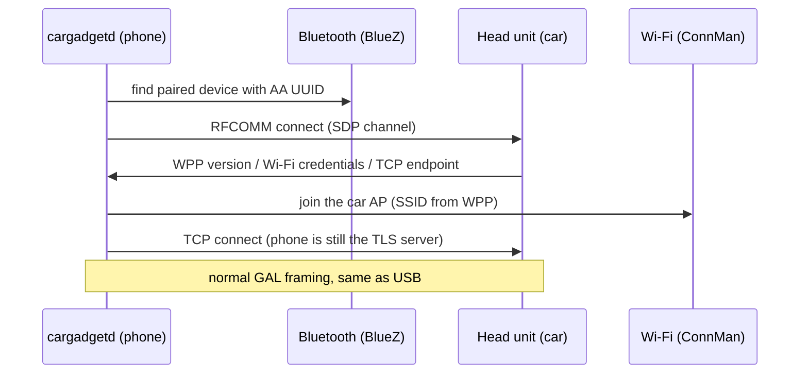

# Wireless Android Auto

cargadgetd normally talks to the head unit over USB (FunctionFS). This document
covers the Wireless Android Auto path: Bluetooth for the setup handshake, the
car's Wi-Fi access point, then TCP + TLS for the normal GAL session.

## Flow



The phone is the **RFCOMM client** and the **TCP client**, but the **TLS
server**. That is the Android Auto wireless layout; do not swap the TLS roles.

## Running

```sh
cargadgetd-md -wireless \
  -wireless-name "" \
  -wireless-channel 0 \
  -wireless-iface wlan0 \
  -certs /usr/lib/cargadgetd/plugins/reversegearhead.so
```

- `-wireless-name` matches the paired head unit name (empty = pick the paired
  device advertising the Android Auto UUID `4de17a00-52cb-11e6-bdf4-0800200c9a66`).
- `-wireless-addr` selects the device by Bluetooth address.
- `-wireless-channel 0` discovers the RFCOMM channel over SDP; `-wireless-ssid`
  forces a Wi-Fi SSID instead of the one received from the car.

The daemon serves a status page on `http://127.0.0.1:9288/` (`-wireless-web`).

## Status page

The page shows one green/red line per prerequisite:

- Bluetooth device paired (AA UUID present)
- Bluetooth link up
- SDP RFCOMM channel
- RFCOMM connected
- WPP version / Wi-Fi credentials / TCP endpoint
- Wi-Fi: current SSID vs expected SSID and IPv4 address
- TCP endpoint and session state

Buttons: **Démarrer** / **Arrêter** control the connection attempt; the
**Rejoindre le Wi-Fi** button asks ConnMan to join the SSID received from the
car. The daemon keeps running so the page stays available.

## Wi-Fi selection

Two sources, in order:

1. **Saved network heuristic**: once the Bluetooth link is up, the daemon looks
   for a ConnMan Wi-Fi service whose SSID matches the Bluetooth device name
   (case-insensitive, or one containing the other). Only networks already saved
   on the phone are considered, so it never joins an unknown AP.
2. **WPP credentials**: `WifiInfoResponse` / `WifiSetupInfo` (and the Wi-Fi
   Direct group name in `WifiVersionRequest`) are authoritative and override the
   heuristic.

## Waze / Google Maps

cargadgetd does **not** project Android apps: it streams its own Sailfish shell
and plugins. Waze and Google Maps are Android apps running in AppSupport, so
they can only reach the car screen through the **Link** plugin, which mirrors
the phone screen:

1. Install Waze (and Google Maps if your AppSupport has Play Services) from
   Aurora Store / your APK source.
2. Open the app on the phone.
3. In the cargadgetd shell, open **Link**.
4. The phone screen is mirrored to the car; touches are forwarded back.

The Link package ships two **setuid root** helpers,
`cargadgetd-linkcap` (Wayland screen capture) and `cargadgetd-linktouch`
(`/dev/uinput` touch injection). The upstream README warns that they can
potentially be used to escalate privileges. Remove the package
(`rpm -e cargadgetd-plugin-link`) if you do not need the mirror.

## Navit maps

Maps live in a dedicated directory:

```sh
mkdir -p ~/Documents/navit-maps
```

Build them from an OSM extract with Navit's `maptool` (Debian package
`maptool`):

```sh
maptool --protobuf -i luxembourg-latest.osm.pbf luxemburg.bin
maptool --protobuf -i belgium-latest.osm.pbf belgium.bin
maptool --protobuf -i france-latest.osm.pbf france.bin
```

Then declare them in `/usr/share/harbour-navit/navit.xml` inside the enabled
`<mapset>`:

```xml
<map type="binfile" enabled="yes" data="~/Documents/navit-maps/luxemburg.bin"/>
<map type="binfile" enabled="yes" data="~/Documents/navit-maps/belgium.bin"/>
<map type="binfile" enabled="yes" data="~/Documents/navit-maps/france.bin"/>
```

`maptool` produces large files: France is about 11 GB from the 5.5 GB PBF.

## Known limitations

- The `libreversegearhead` certificate expired on 2026-10-28; at least one car
  accepts the TLS handshake anyway, but this must be refreshed for others.
- The WPP field numbers are implemented for both documented layouts (A and B)
  and logged raw; the VW MIB3 exchange still needs a capture to confirm which
  one it uses.
- The RFCOMM channel is discovered over SDP; if SDP fails the daemon falls back
  to channel 8 and logs it.
