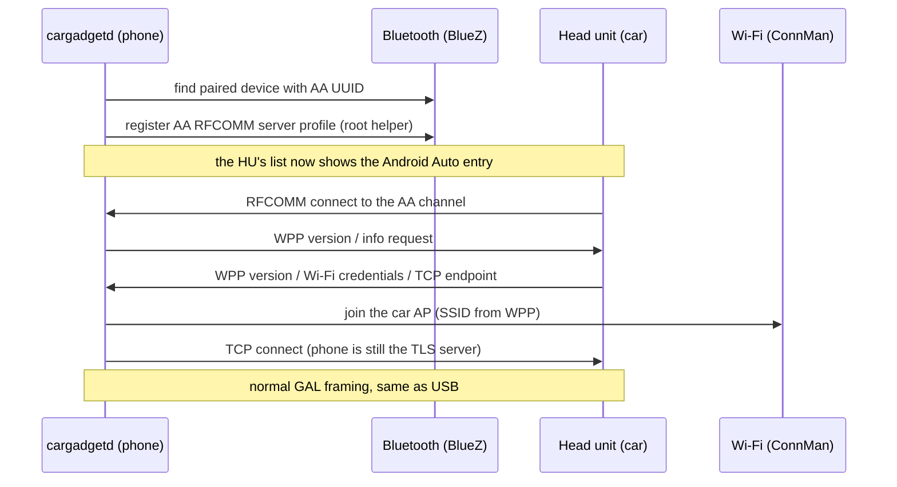
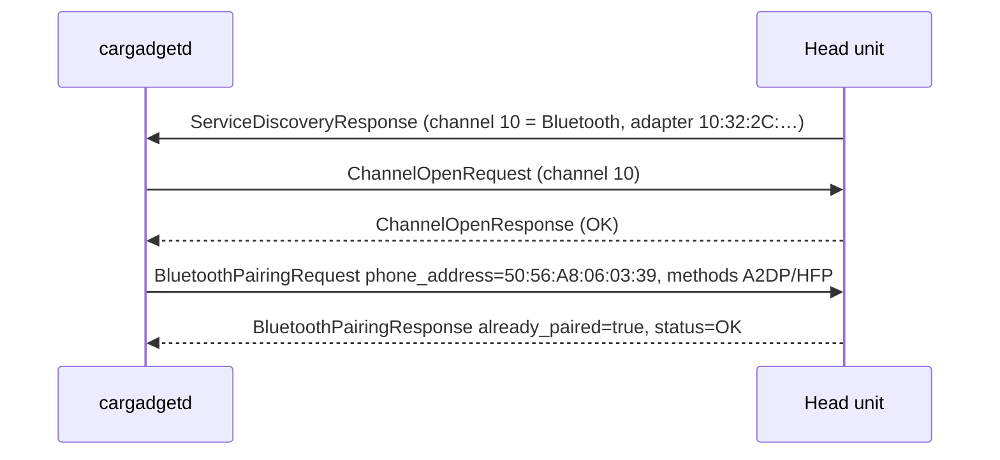
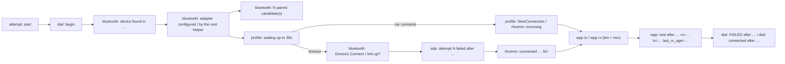
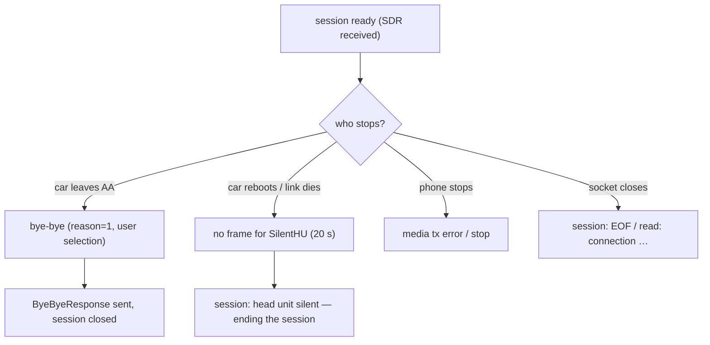

# Wireless Android Auto

cargadgetd normally talks to the head unit over USB (FunctionFS). This document
covers the Wireless Android Auto path: Bluetooth for the setup handshake, the
car's Wi-Fi access point, then TCP + TLS for the normal GAL session.

## Flow



The phone is the **RFCOMM client** and the **TCP client**, but the **TLS
server**. That is the Android Auto wireless layout; do not swap the TLS roles.

Two RFCOMM directions exist in the wild. The daemon registers an Android Auto
**server** profile (UUID `4de17a00-…`, RFCOMM channel 8, profile version 1.0) so
the head unit discovers the phone as an Android Auto device and connects to it;
if nothing arrives within 20 s it falls back to the classic client-only path
(dial the HU channel learned over SDP).

## Running

```sh
cargadgetd-md -wireless \
  -wireless-name "" \
  -wireless-channel 0 \
  -wireless-iface wlan0 \
  -certs /usr/lib/cargadgetd/plugins/reversegearhead.so
```

- `-wireless-name` matches the paired head unit name (empty = pick the paired
  device advertising the Android Auto UUID `4de17a00-52cb-11e6-bdf4-0800200c9a66`).
- `-wireless-addr` selects the device by Bluetooth address.
- `-wireless-channel 0` discovers the RFCOMM channel over SDP; `-wireless-ssid`
  forces a Wi-Fi SSID instead of the one received from the car.

The daemon serves a status page on `http://127.0.0.1:9288/` (`-wireless-web`).

## First pairing

The first wireless setup normally needs one **USB** session: plug the phone,
let the car run wired Android Auto once (the head unit registers the phone and
its wireless trust), then unplug. Without that step many head units do not list
the phone over Bluetooth, or cannot complete the WPP handshake. The daemon
powers the Bluetooth adapter and makes it discoverable, but it cannot perform
the car's first-time trust step.

The status page shows the adapter state (Powered / Discoverable / Pairable) and
the device properties (Bonded / Trusted / ServicesResolved).

### Two names for one phone

The head unit names the phone differently in each mode, and the page says so
rather than leaving the user to guess:

| Mode | Name source | Example |
| --- | --- | --- |
| Wireless | BlueZ adapter alias (`Adapter1.Alias`) | `Manolla` |
| USB cable | gadget product string, built from `/etc/machine-info` `PRETTY_HOSTNAME` | `Jolla Phone (2026)` |

Both are the same phone. The car lists the **Bluetooth** name for Wireless
Android Auto; the USB name only appears while the cable is plugged in.

### How the head unit links the USB session to the Bluetooth bond

Names are labels; they are never the link. Three independent identities exist:

| Identity | Value | Where it comes from |
| --- | --- | --- |
| USB device | `18d1:2d00` + descriptor strings | the phone's gadget |
| Bluetooth bond | `BD_ADDR` + link key | BlueZ / the car |
| AA session | reversegearhead TLS certificate | the same in USB and Wi-Fi |

The missing piece on a plain Linux MD is the bridge between the first two.
Android Auto carries a **Bluetooth channel** (service 10) inside the normal
session: the MD opens it and sends `BluetoothPairingRequest` with its
`phone_address`. The head unit stores "this USB/Wi-Fi session belongs to that
Bluetooth device", which is what lets it offer Wireless Android Auto later.

cargadgetd implements it:



Log lines to look for:

```
SDR bluetooth channel=10 adapter="10:32:2C:50:5D:5E" methods=[2 4]
bluetooth: pairing request sent on channel 10 address=50:56:A8:06:03:39 name="Manolla" method=2
bluetooth: pairing response already_paired=true status=1 (0 none, 1 ok, 2 fail)
```

`already_paired=true` confirms the car recognised the phone's Bluetooth bond.
The address comes from `Adapter1.Address`, never from a configured name.


## Root-only D-Bus calls (Sailfish)

Sailfish answers `org.freedesktop.DBus.Error.AuthFailed` (with an empty message)
to `Adapter1` property writes coming from a normal user session, and ConnMan
refuses `Service.Connect` the same way. The daemon therefore asks the setuid
`cargadgetd-gadget` helper for both:

```sh
cargadgetd-gadget -bt-adapter /org/bluez/hci1   # Powered, no timeouts, Pairable, Discoverable
cargadgetd-gadget -wifi-connect MULTIVAN        # ConnMan Service.Connect as root
```

`DiscoverableTimeout` is set to 0 ("stay discoverable") because BlueZ otherwise
clears the flag after its timeout and the phone disappears from the head unit's
list mid-session. Both helpers exit immediately; the daemon keeps running as the
normal user.

To check from another machine that the phone advertises the service:

```
bluetoothctl --timeout 12 scan on
bluetoothctl info <phone-address>   # expects 4de17a00-… under "Vendor specific"
```

## Status page

The page shows one green/red line per prerequisite:

- Bluetooth device paired (AA UUID present)
- Bluetooth link up
- SDP RFCOMM channel
- RFCOMM connected
- WPP version / Wi-Fi credentials / TCP endpoint
- Wi-Fi: current SSID vs expected SSID and IPv4 address
- TCP endpoint and session state

Buttons: **Démarrer** / **Arrêter** control the connection attempt; the
**Rejoindre le Wi-Fi** button asks ConnMan to join the SSID received from the
car; **Redémarrer** re-execs the daemon from the installed binary (reloads an
updated build and resets the controller) without a shell. The daemon keeps
running so the page stays available.

Above the buttons, the **Quoi faire** box gives exactly one instruction for the
current state ("allume le contact", "sur l'écran de la voiture : Appareils
mobiles → « Manolla » → Android Auto", "tu peux rouler"), so the driver never
has to read the check list. The daemon never gives up: after a failed attempt it
watches the Bluetooth link, the ConnMan state and the association, and starts a
new cycle as soon as one of them changes (or after 15 s at most).

### Wired path monitoring

The page also observes the USB daemon, which it does not own:

| Line | Source |
| --- | --- |
| Service USB | `systemctl is-active cargadgetd-aoa.service` |
| Mode | live gadget `idVendor` (`0x0e8d` ask, `0x18d1` accessory) |
| Session USB | a `cargadgetd-md` process without `-wireless` |
| Log | tail of `~/cargadgetd.log` |

The state that looks like "the car refuses the phone" is the launcher unit
stopped: with `daemon.transport: usb` the waiter must run *before* the cable is
plugged, otherwise the phone enumerates as plain mass storage. The
**Réparer l'USB** button runs `cargadgetd-gadget -aoa-service start` (setuid) and
the page then follows the unit, so no shell is needed.

Configfs gadget directories are `0771 root:system`: `filepath.Glob` cannot be
used there (Go opens every intermediate directory), only `ReadDir` on the parent
plus a direct `ReadFile` of `idVendor`.


Logs: `~/wireless.log` (wireless daemon) and `~/cargadgetd.log` (USB daemon).
The status page lists the failing check and the raw WPP exchange. It polls
`/status` once a second and patches the DOM in place, so the page never reloads
or flickers (a `meta refresh` did, badly, on the phone).

### WPP, verified against Android Auto 18.1

The stock client (from the gearhead APK) uses exactly the framing cargadgetd
does, and the same ids:

| Framing | value |
| --- | --- |
| header | 2-byte big-endian payload length, 2-byte big-endian message type |
| max length | 1024 |
| first packet (phone → HU) | `WifiInfoRequest` (2), sent as soon as RFCOMM connects |
| ids | 1 Start, 2 InfoRequest, 3 InfoResponse, 4 VersionRequest, 5 VersionResponse, 6 ConnectStatus, 7 StartResponse, 8 Ping, 9 PingResponse, 10 ConnectionRejection, 11 SetupInfo |

The only behavioural difference: the stock client retries `WifiInfoRequest`
**twice** and then closes the socket and restarts WPP, while cargadgetd used to
retry forever. Silent retries hid the real cause — a car that answers nothing is
usually on another RFCOMM service than the one we dialled — so the attempt now
fails with `no WifiInfoResponse after 2 retries`.

`pairing_method` on the Bluetooth channel is not a profile: the real enum is
OOB=1, NUMERIC_COMPARISON=2, PASSKEY_ENTRY=3, PIN=4, and stock Android picks
NUMERIC_COMPARISON then PIN (never OOB).

### The RFCOMM channel is 7 on a VW MIB3

The phone's BlueZ SDP cache (`/var/lib/bluetooth/<adapter>/cache/<car>`) contains
the head unit's records in clear text. Decoding a VW MIB3:

```
0x0001000A  ServiceClassIDList = 4DE17A00-52CB-11E6-BDF4-0800200C9A66   ← Android Auto
            ProtocolDescriptorList = L2CAP + RFCOMM channel 7
            ServiceName = "VW SPP Service"

0x0001000B  UUID 00001101 (generic SPP) — RFCOMM channel 8
```

Channel 8, the old hard-coded fallback, is the car's **generic SPP** service: it
accepts the connection and then ignores WPP, which looked like "the car never
answers". When SDP fails (the unit refuses the L2CAP PSD 1 connect while its
baseband link is not fully up), the daemon now probes the likely channels by
connecting and sending a `WifiInfoRequest`, and keeps the one that answers.

## Reading the log
Every attempt is bounded and self-documenting: timestamps carry milliseconds and
each phase logs its duration, so one attempt can be read top to bottom without a
sniffer.



| Log line | Meaning |
| --- | --- |
| `attempt: FAILED after 1m34s: voiture absente …` | whole attempt summary; the duration matters |
| `bluetooth: Device1.Connect failed after 7.7s: br-connection-page-timeout` | the car did not answer the page |
| `bluetooth: link never came up within 10s (20 polls, last=down)` | ACL link never established |
| `sdp: attempt 1 failed after 7.7s: … host is down` | SDP L2CAP connect timed out (7.7 s is the baseband page timeout) |
| `profile: NewConnection from … fd=` | the head unit connected to the phone's AA service |
| `rfcomm: connected … (fd=)` | client path connected; the channel and fd identify the service |
| `wpp tx/rx: id=… len=… hex=…` | exact WPP bytes, both directions |
| `wpp: end after … rx=0 tx=1 last_rx_age=…` | the car never answered the info request |
| `wifi: join #N … hors de portée` | ConnMan cannot see the car AP yet |

A head unit that never answers `wpp tx: id=2` is the signature of a wrong
RFCOMM channel (connected to another service) or of a car that wants the phone
to wait: the SDP channel lookup above it tells which case applies.


### Discovery, not a fixed target

Every bonded device is a candidate, tried in turn, so a head unit that is
switched off does not stop the daemon from finding one that is on. A device is
only reported as present once its ACL link comes up; "candidate" in the log
means "read from the BlueZ cache", not "in range".

With several units paired, name the one to dial in the configuration:

```yaml
daemon:
  peer: "AA:BB:CC:DD:EE:FF"   # exact address
  # peer: "CAR BT"            # or a name (substring)
  # peer: auto                # discovery (the default)
```

An address is exact: nothing is ranked, so a paired PC or another phone can
never take the cycle. A name is a substring match, which is how a unit whose
address changes at every boot is still named. `-wireless-addr` overrides both
for a bench run.

With `auto` (the default) the daemon orders the bonded devices itself:
audio/video class first (only a car kit has it), then the one whose link is up,
then the one advertising the Android Auto UUID, and a unit that just failed to
page is demoted for two minutes.

Every attempt says which device it dials and why:

```
wireless: peer from daemon.peer address name="" addr="AA:BB:CC:DD:EE:FF" channel=7 iface=wlan0
```

An earlier release documented a `~/.cache/cargadgetd-headunit` pin file here.
It was never implemented; `daemon.peer` replaces it.

### A deleted log is recreated

The daemon is started with `-log-file` and owns its log: if the file is removed
or rotated while a session runs, it reopens it. A shell redirect would keep
writing into the unlinked inode, which is how a whole session can leave no trace
(a deleted `wireless.log` looked like "nothing happened").

## When the car ends the session

A projection can end in four ways, and the log names which one happened. Only
the first is ours to fix; the others are the car deciding.



| Log line | Meaning |
| --- | --- |
| `head unit bye-bye (reason=N, …) — acknowledging` | the car asked to end the projection (`ByeByeRequest`, msg `0x000f`); reasons are `1 user selection`, `2 device switch`, `3/4 not supported`, `5 probe`. The daemon answers with `ByeByeResponse` (`0x0010`) before closing, which is what a real phone does — an unanswered bye-bye leaves the car waiting |
| `session: head unit silent for 20s — ending the session` | the car stopped sending anything (it rebooted, or the link dropped). Without this check the socket stays half-open and a phone pushes frames into it for minutes, never retrying: the "it worked once and never again" state |
| `session: read unblocked after N frames: …` | the reason above, reported instead of the deadline error used to unblock the read |
| `video catch-up: skipped N ticks` | the send pipe is stalled; with the above it should no longer be seen for minutes |

`session.SilentHU` (20 s) is the silence budget: the head unit pings about once
a second, so only a dead car trips it.

## Video bitrate

`video.bitrate_kbps` pins the CBR target and defaults to **1500**, which is the
only rate ever run end to end here: all 24 recorded sessions on the two bench
units opened at 1.5 Mbps and none needed the adaptive step-down. It keeps text
and map lines crisp and cuts the keyframe bursts that stress a car decoder.

`bitrate_kbps: 0` asks for the frame-size budget instead: ~20 KB per frame,
about 4.8 Mbps at 30 fps, keyframes near 100 KB. That is the rate a VW MIB3
disliked — its decoder rebooted under a heavy stream over USB — and it has never
been run on a real unit since, so it is an explicit choice, not a default.

The adaptive path is bounded by the open rate: `stepUp` never exceeds it, and
`stepDown` stops at `crispFloor` (1.5 Mbps). Opening at 1500 therefore pins the
session at 1500 — which is what the two units have been validated with.

The bitrate does **not** follow the resolution: `hwBitrate` ignores width and
height on purpose, because a bitrate that shrinks with a smaller picture makes
frames mushy for no gain. The consequence is worth knowing before raising
`video.size`: the same ~4.8 Mbps spread over 1920×1080 is 0.077 bits per pixel
instead of 0.174 at 1280×720, so the bigger mode is a *softer* picture unless
the rate is raised too, and `clampBps` stops at 6 Mbps. Matching 720p's
bits-per-pixel at 1080p would need about 10.8 Mbps, which the encoder is not
given.

### Resolution: `auto` is not always the small mode

`video.size: auto` follows the head unit in this order: an exact codec match for
the touch-screen size, then a content-rectangle match, then **`video_configs[0]`
as a last resort**. That last step assumes index 0 is a sensible default. On a
VW MIB3 it is not: the unit advertises

```
0:1920x1080 m=559x468 ui=1361x612   1:1280x720 m=0x144 ui=1280x576   2:800x480 ...
```

and sends `touch=unset` (`touch=0x0` in the log), so `auto` skips both match
steps and picks **1920×1080** — 2.25× the pixels and 60% of the frame is black
letterbox, to display a content area only 6% wider than 1280×576.

Pinning the size removes the guess:

```yaml
video:
  size: 1280x720
```

Measured on that unit: `SDR video using 1280x720 m=0x144 ui=1280x576
pad=0,72 config_index=1 (want idx=-1 size=1280x720)`. The Melia advertises a
single 1280×720 mode and declares `touch=1280x480`, so both values agree there.

`TestAutoWithNoTouchSizeFallsBackToConfigZero` pins this behaviour: if the
fallback ever changes, that test says so instead of a car showing a softer
picture after an innocent refactor.

```yaml
video:
    encoder: droidmedia
    size: 1280x720
    bitrate_kbps: 1500
```

The daemon logs the value it actually uses on every session:

```
video: CBR target 1.5 Mbps (video.bitrate_kbps=1500)
large video AU 143210B
```

`large video AU` appears above 48 KB, i.e. for keyframes and scene changes: it
is the quickest way to see whether the burst is still heavy.

## Wi-Fi selection

Two sources, in order:

1. **Saved network heuristic**: once the Bluetooth link is up, the daemon looks
   for a ConnMan Wi-Fi service whose SSID matches the Bluetooth device name
   (case-insensitive, or one containing the other). Only networks already saved
   on the phone are considered, so it never joins an unknown AP.
2. **WPP credentials**: `WifiInfoResponse` / `WifiSetupInfo` (and the Wi-Fi
   Direct group name in `WifiVersionRequest`) are authoritative and override the
   heuristic.

## Optional car apps

The ftuna aarch64 repository ships two app plugins:

| Package | Purpose |
|---|---|
| `cargadgetd-plugin-link` | Mirrors the phone screen to the car (Waze/Google Maps), plus two setuid helpers |
| `cargadgetd-plugin-maps` | MapLibre map app for the car shell |

```sh
devel-su rpm -Uvh cargadgetd-plugin-link-*.rpm cargadgetd-plugin-maps-*.rpm
```

The plugins are `.so` files in `/usr/lib/cargadgetd/plugins/`; the shell loads
them on the next session and lists them in the app grid.

### The map tile needs OSM Scout Server, and the server needs its storage registered

`cargadgetd-plugin-maps` renders MapLibre and fetches everything from the local
OSM Scout Server:

```
http://127.0.0.1:8553/v1/mbgl/style?style=%s
http://127.0.0.1:8553/v1/mbgl/tile?style=%s&x=%d&y=%d&z=%d
```

A style request that answers `404` with `Error while getting Mapbox GL style`
does **not** mean the maps are missing. It means the server has no storage
registered with its Map Manager, so it cannot find the data it already has. On
the bench the folder held 6.9 GB and every request failed for that reason.

Registering it is one DBus call, and the state is persisted in the folder
(`files.sqlite`, `countries_requested.json`), so it survives a restart of the
service:

```sh
S=io.github.rinigus.OSMScoutServer
M=/io/github/rinigus/OSMScoutServer/manager
I=io.github.rinigus.OSMScoutServer.manager
busctl --user call $S $M $I createDirectory s "$HOME/Maps.OSM"
busctl --user call $S $M $I addCountry s "europe/belgium"
busctl --user call $S $M $I getUpdates
```

Two more details worth knowing:

- there is **no style called `default`**. The installed ones are `mc`, `mc-en`,
  `mc-car`, `mc-car-en`, `osmbright`, `osmbright-en`, `osmbright-car` and
  `osmbright-car-en` in `/usr/share/harbour-osmscout-server/styles/mapboxgl/styles/`;
  the plugin asks for `osmbright`;
- `/v1/mbgl/sprite` answers `404` even when the map renders: the sprite only
  carries POI and shield icons, and the files are in
  `styles/mapboxgl/sprites/`.

Verify with:

```sh
curl -s -o /dev/null -w "%{http_code}\n" \
  "http://127.0.0.1:8553/v1/mbgl/style?style=osmbright"          # 200
curl -s -o /dev/null -w "%{http_code}\n" \
  "http://127.0.0.1:8553/v1/mbgl/tile?style=osmbright&x=32&y=21&z=6"  # 200
```

AppSupport, microG and Aurora Store are already installed on a stock Jolla
Phone 2026. Install Waze (and Google Maps if your AppSupport has the Play
Services it needs) from Aurora Store, open the app on the phone, then open
**Link** in the cargadgetd shell.

## Waze / Google Maps

cargadgetd does **not** project Android apps: it streams its own Sailfish shell
and plugins. Waze and Google Maps are Android apps running in AppSupport, so
they can only reach the car screen through the **Link** plugin, which mirrors
the phone screen:

1. Install Waze (and Google Maps if your AppSupport has Play Services) from
   Aurora Store / your APK source.
2. Open the app on the phone.
3. In the cargadgetd shell, open **Link**.
4. The phone screen is mirrored to the car; touches are forwarded back.

The Link package ships two **setuid root** helpers,
`cargadgetd-linkcap` (Wayland screen capture) and `cargadgetd-linktouch`
(`/dev/uinput` touch injection). The upstream README warns that they can
potentially be used to escalate privileges. Remove the package
(`rpm -e cargadgetd-plugin-link`) if you do not need the mirror.

## Navit maps

Maps live in a dedicated directory:

```sh
mkdir -p ~/Documents/navit-maps
```

Build them from an OSM extract with Navit's `maptool` (Debian package
`maptool`):

```sh
maptool --protobuf -i luxembourg-latest.osm.pbf luxemburg.bin
maptool --protobuf -i belgium-latest.osm.pbf belgium.bin
maptool --protobuf -i france-latest.osm.pbf france.bin
```

Then declare them in `/usr/share/harbour-navit/navit.xml` inside the enabled
`<mapset>`:

```xml
<map type="binfile" enabled="yes" data="~/Documents/navit-maps/luxemburg.bin"/>
<map type="binfile" enabled="yes" data="~/Documents/navit-maps/belgium.bin"/>
<map type="binfile" enabled="yes" data="~/Documents/navit-maps/france.bin"/>
```

`maptool` produces large files: France is about 11 GB from the 5.5 GB PBF.

## Lab head unit: Melia 4.0 (universal 2-DIN)

A cheap universal 2-DIN unit (`CAR BT_603F`, BT MAC `41:00:00:00:9E:F0`) is
the bench head unit: it accepts the phone over USB, no car, no risk.

```
OS  : Melia4.0-20220107
APP : YCar628-M1280-20251229-1439
MCU : AB5301_20250528_1101
```

What it teaches:

- **Not Android.** Melia is a small Linux/Qt head-unit OS; Android Auto is a
  dedicated app (`YCar628`). It is far more stable than the VW MIB3: a broken
  session stops, the unit itself does not reboot.
- **Wired Android Auto works** with our stream (version 1.3, SDR, 1280x720,
  touch and audio), which validates the AVC pipeline on a second decoder.
- **Wireless Android Auto works, on RFCOMM channel 1.** SDP (PSM 1) is refused
  and 7/8/9 are refused too, which is why the probe looked like a dead end until
  it scanned 1–30: the service answers on channel **1**. The rest of the flow is
  the standard one: WPP gives `ssid=carplay_wifi_XXXX`, `key=12345678`,
  `security=8`, then `StartRequest` with `192.168.43.1:6730`, the phone joins the
  AP and the TLS session runs.
- **Its SSID is new at every session** (`34A5`, `B2AB`, `DC02`, `5059`, `0D60`)
  and the wireless mode times out quickly, so the join has to happen within
  seconds of the WPP exchange — no room for a 90s SDP-first cycle.
- **ConnMan must do the join.** On Sailfish `connmand` runs with
  `--noplugin=wifi` and `/var/lib/connman` does not exist, so a provisioning file
  is impossible, and `Service.Connect` on an unsaved AP is refused
  ("no saved wifi service"). What works is a `net.connman.Agent` that answers
  `RequestInput("Passphrase")`: ConnMan then associates, runs DHCP, sets the
  route and updates its own UI. Associating through wpa_supplicant directly does
  connect, but leaves ConnMan unaware: the interface keeps its previous address,
  the UI still shows the old network, and the TCP dial goes out the wrong route.
- The pairing PIN it displays (`0000`) is not what is used: BlueZ pairs with
  the six-digit numeric comparison and `gadgetctl -bt-pair` confirms it. What
  broke pairing was a stale bond, not the PIN length.
- Its Bluetooth MAC is fixed, so one pairing lasts.

`encprobe` (cmd/encprobe) encodes a moving pattern on the phone alone, without
a head unit, and reports stalls: `encprobe -seconds 600`. It proved the encoder
healthy (436 frames, 0 errors) while a session on the unit was frozen, which is
what pointed at the codec wedge rather than the car.

## Known limitations

- The `libreversegearhead` certificate expired on 2026-10-28; at least one car
  accepts the TLS handshake anyway, but this must be refreshed for others.
- The WPP field numbers are implemented for both documented layouts (A and B)
  and logged raw; the VW MIB3 exchange still needs a capture to confirm which
  one it uses.
- The RFCOMM channel is discovered over SDP; if SDP fails the daemon falls back
  to channel 8 and logs it.
